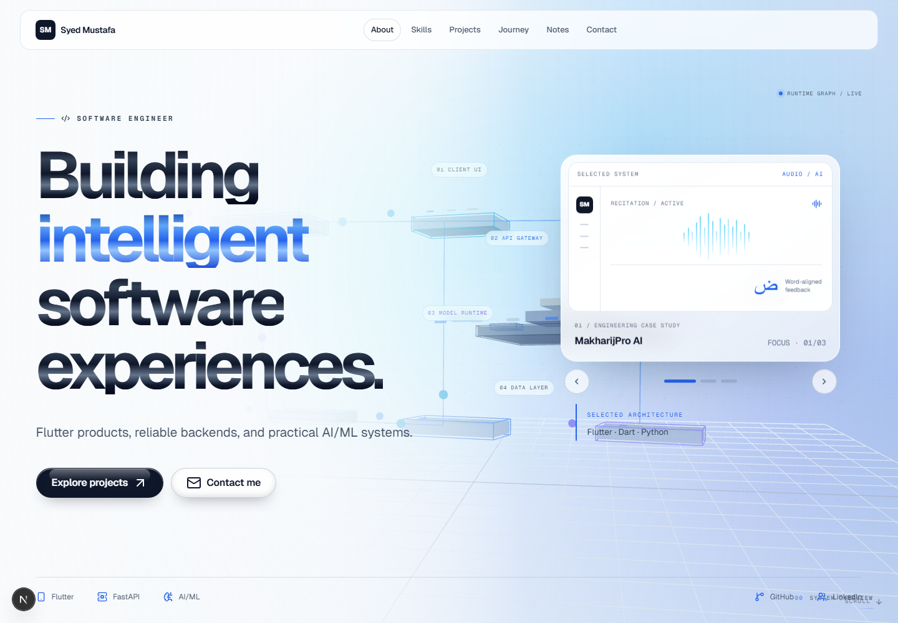
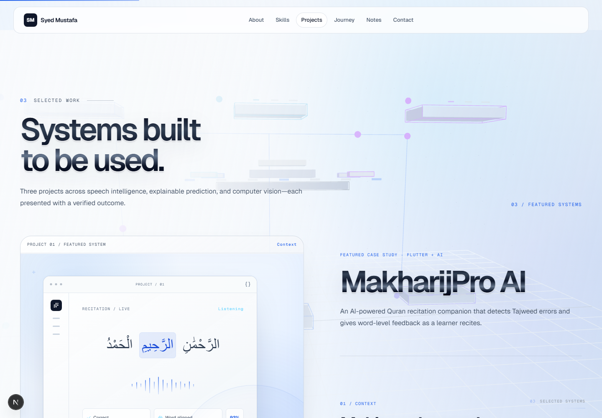
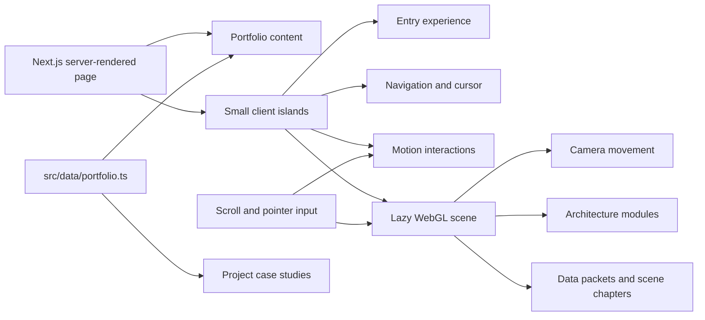

<div align="center">

# Syed Mustafa — Software Engineer

### Building intelligent software experiences.

A motion-rich engineering portfolio showcasing Flutter products, dependable backends, and practical AI/ML systems through interactive case studies.

[](https://nextjs.org/)
[](https://react.dev/)
[](https://www.typescriptlang.org/)
[](https://threejs.org/)
[](https://vercel.com/)

[Explore the code](#-getting-started) · [See how it works](#-how-the-experience-works) · [Edit the content](#-customizing-the-portfolio)

</div>



## ✦ The experience

This is not a card-grid portfolio. It is designed as a guided engineering narrative: an identity-led entrance, an interactive system landscape, inspectable capabilities, real project evidence, and focused case-study pages.

- **Interactive 3D architecture background** that responds to pointer movement and page progress.
- **Session-aware entry sequence** that introduces the `SM` identity without replaying on every visit.
- **Three engineering case studies** with context, problem, implementation, evidence, and verified outcomes.
- **Scroll-led storytelling** with changing scene chapters, project reveals, rules, and timelines.
- **Responsive interaction model** that simplifies expensive effects on compact and touch devices.
- **Accessible by design** with semantic structure, keyboard navigation, visible focus, skip navigation, and reduced-motion support.
- **Centralized typed content** so portfolio information can be edited without rewriting components.

## ◈ Featured work



| Project | Focus | Verified result |
| --- | --- | --- |
| **MakharijPro AI** | Flutter, FastAPI, streaming Arabic speech recognition | Word-level reference workflow across all 6,236 Quran ayahs |
| **Cardiac Risk Model Explorer** | Leakage-safe ML, explainability, calibrated prediction | 0.959 ROC-AUC and 96.4% sensitivity on the documented held-out test set |
| **Handwritten Character Recognition** | TensorFlow, OpenCV, Flask, usable model inference | 90.01% accuracy across 47 classes on 18,800 held-out test images |

Each project opens into a dedicated case-study route at `/work/[slug]` rather than ending at a visual preview.

## ⚙ How the experience works



### 1. Initial entry

`EntryExperience` presents a short branded introduction and records it in `sessionStorage`. It plays once per browser session, never blocks the actual document, and is skipped for reduced-motion users.

### 2. Immersive background

The WebGL experience is dynamically loaded on the client. React Three Fiber renders the system modules while GSAP ScrollTrigger converts page progress into camera movement, scene depth, chapter state, and data motion. A CSS fallback remains visible while the scene loads or when WebGL is unavailable.

### 3. Content and case studies

The home page reads its identity, navigation, technologies, projects, education, achievements, and writing links from one typed data file. Project slugs generate dedicated case-study pages while the visual components select the correct system preview for each project.

### 4. Progressive enhancement

Important text, navigation, links, and project information remain normal HTML. Pointer effects, motion, and WebGL enrich the experience without becoming the only way to access the content.

## 🧰 Technology stack

| Area | Technologies |
| --- | --- |
| Framework | Next.js 16, React 19, TypeScript |
| Styling | Tailwind CSS 4, custom design tokens, responsive CSS |
| UI primitives | Radix UI, shadcn-style components, Lucide icons |
| Motion | Motion, GSAP ScrollTrigger, CSS transitions |
| 3D | Three.js, React Three Fiber |
| Typography | Local Geist Sans and Geist Mono |
| Quality | ESLint, TypeScript, Next.js production build |
| Deployment | Vercel-ready; no database or environment variables required |

## 🚀 Getting started

### Requirements

- Node.js **20.9 or newer**
- npm

### Run locally

```bash
git clone https://github.com/mustfaaaa/Portfolio.git
cd Portfolio
npm install
npm run dev
```

Open [http://localhost:3000](http://localhost:3000).

### Production check

```bash
npm run lint
npm run build
npm run start
```

| Command | Purpose |
| --- | --- |
| `npm run dev` | Starts the local development server with fast refresh |
| `npm run lint` | Checks code quality and Next.js rules |
| `npm run build` | Creates and validates the optimized production build |
| `npm run start` | Runs the completed production build locally |

## ✎ Customizing the portfolio

Most personal content is intentionally centralized in:

```text
src/data/portfolio.ts
```

Update these objects to personalize the website:

| Content | Where to edit |
| --- | --- |
| Name, role, headline, bio, email, location | `portfolio.identity` |
| Canonical production URL and SEO copy | `portfolio.site` |
| GitHub and LinkedIn | `portfolio.links` |
| Navigation | `portfolio.navigation` |
| Skills and contextual descriptions | `portfolio.skills` |
| Projects, links, outcomes, and case-study content | `portfolio.projects` |
| Experience and education | `portfolio.experience`, `portfolio.education` |
| Achievements and technical notes | `portfolio.achievements`, `portfolio.articles` |

Project routes are generated from each project's `slug`. For example:

```ts
{
  slug: "my-project",
  title: "My Project",
  technologies: ["Flutter", "FastAPI"],
  context: "Why the project needed to exist.",
  problem: "The engineering problem that had to be solved.",
  engineering: ["Important implementation decision"],
  outcome: "A truthful, verifiable result."
}
```

Do not add unverified metrics, employers, testimonials, or project outcomes. The portfolio is structured to look strong through evidence and presentation—not invented claims.

## 🗂 Project structure

```text
src/
├── app/
│   ├── work/[slug]/page.tsx      # Dynamic case-study pages
│   ├── globals.css               # Design system and responsive styling
│   ├── layout.tsx                # Metadata and global application shell
│   └── page.tsx                  # Main portfolio route
├── components/
│   ├── motion/                   # Reusable reveal and magnetic interactions
│   ├── ui/                       # Shared UI primitives
│   ├── webgl/                    # 3D scene and lazy client loader
│   ├── entry-experience.tsx      # Session-aware opening sequence
│   ├── featured-case-study.tsx   # Featured project storytelling
│   ├── hero.tsx                  # Hero and project selector
│   ├── navigation.tsx            # Responsive navigation and progress
│   ├── portfolio-sections.tsx    # Main page sections
│   └── project-visual.tsx        # Project-specific visual systems
├── data/
│   └── portfolio.ts              # Typed source of truth for content
└── assets/fonts/                 # Local Geist font files

public/
├── images/                       # Portfolio imagery
└── screenshots/                  # README previews
```

## ♿ Accessibility and performance

- Semantic headings, landmarks, links, and buttons
- Keyboard-operable menus and project controls
- Visible focus treatment and a skip-to-content link
- `prefers-reduced-motion` support for entry, scroll, and cursor effects
- Touch-device and mobile simplification for expensive interactions
- Lazy client loading for the Three.js scene
- Local fonts and optimized static imagery
- Transform/opacity-driven animation where possible
- No database, authentication layer, or unnecessary backend runtime

## ▲ Deploying to Vercel

1. Import `mustfaaaa/Portfolio` into Vercel.
2. Keep the detected **Next.js** framework preset.
3. Use the default `npm run build` command.
4. No environment variables are required.
5. After deployment, replace `https://your-domain.vercel.app` in `src/data/portfolio.ts` with the real production URL so canonical metadata, sitemap, robots, and JSON-LD point to the correct domain.

## Current content notes

- Exact internship organizations, role titles, dates, and contributions still need verified details.
- Certification entries remain intentionally unpublished until real credentials are supplied.
- Testimonials are not displayed as real endorsements without genuine approved quotes.
- The canonical production URL remains configurable until the final Vercel domain is known.

---

<div align="center">

Designed and engineered by **[Syed Mustafa](https://www.linkedin.com/in/syed-mustafa-7b4b2438a/)**<br>
[GitHub](https://github.com/mustfaaaa) · [Email](mailto:shahsyedmustfa@gmail.com)

</div>
